# Geomagnetic Data Lab — Scientific Python & 3D Visualization

**A reproducible, software-only scientific portfolio** by **Ismael Berja Ruiz**  
Python 3.11+ · Data quality · Time series · Geospatial statistics · Interactive 3D Earth · CI

> **Every station and every numerical observation in this repository is FICTIONAL.** This is a standalone technical demonstration inspired by methods studied during a Physics BSc project on the May 2024 geomagnetic storm. It does **not** contain observations, derived statistics, plots, code, licensed media, or datasets from INTERMAGNET, WDC Kyoto, or the private research archive. The demonstration uses 9–15 May 2024 dates *only as artificial test timestamps*.

## Featured: a sampled regional 3D globe

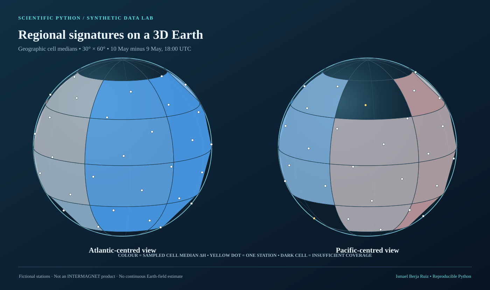

**What you are seeing:** a 3D visualization of **56 invented station locations**, with **54 usable paired samples** at each of two UTC times. Coloured latitude/longitude cells require **at least two** fictional observations and show their **median ΔH**. Unmeasured regions are not interpolated into a global field.

**[Explore the interactive 3D Earth](figures/interactive_synthetic_globe.html)** — download the HTML file and open it in a browser. Rotate/zoom, compare **17:00 vs 18:00 UTC**, and toggle between **regional medians, synthetic XYZ vector-change arrows and station-point ΔH**. No installation, account, web request or third-party library is needed.

## Second 3D view: local vector changes

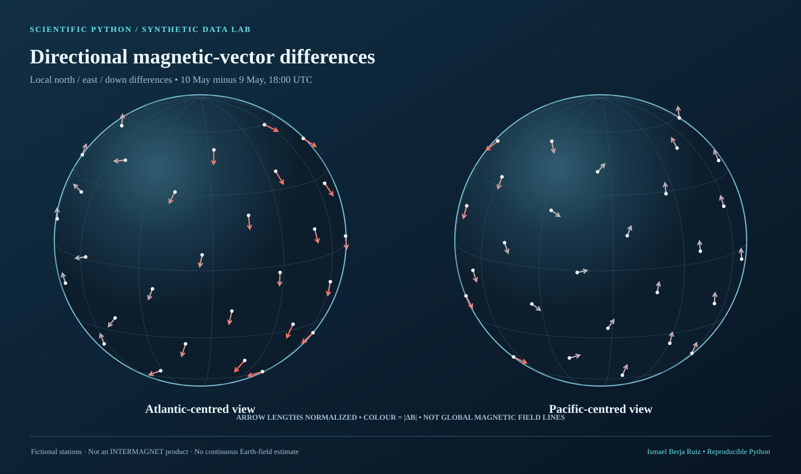

Vectors follow the explicit geographic convention **X = north, Y = east, Z = down**. Arrow length is normalized for legibility; it is **not** a full Earth magnetic-field simulation. The vector magnitude and scalar ΔH are different statistics.

## Spectral analysis — synthetic spectrogram (STFT)

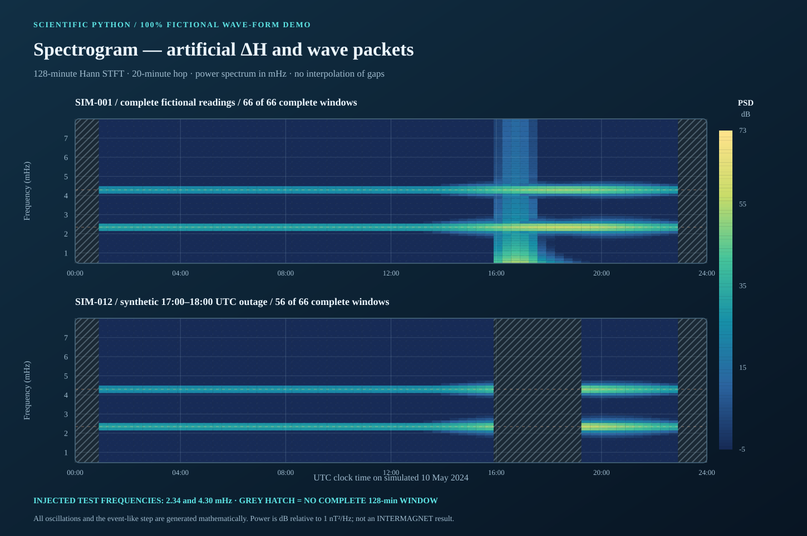

The new **time-frequency spectrogram** uses a **128-minute Hann window** and a **20-minute step** with a numerical Fourier transform implemented in pure Python. The example starts from the fictional same-UTC-minute ΔH signal and **explicitly adds two artificial oscillations at 2.34 and 4.30 mHz** so the frequency bands can be recognized. The SIM-012 sample has a 17:00–18:00 UTC outage: *every analysis window overlapping missing samples is hatched*, not filled or interpolated. The heat map reports one-sided power spectral density (PSD) in **dB relative to 1 nT²/Hz**. This is a **signal-processing demonstration**, not a measured 2024-storm spectrum. [Reproduce and check the STFT](src/geomag_demo/spectrogram.py) · [Method and limits](docs/METHODOLOGY.md).

## Scientific analysis: how the signal varies with latitude, longitude and time

This is the extended **research-method demonstration** inspired by the geographic analysis in my Physics BSc thesis. Unlike the two-instant globe snapshots, these new plots follow **144 hourly UTC comparisons over six days** for **56 completely invented observatories**.

| Six-day latitude × time medians | Six-day longitude × time medians |
| :---: | :---: |
| 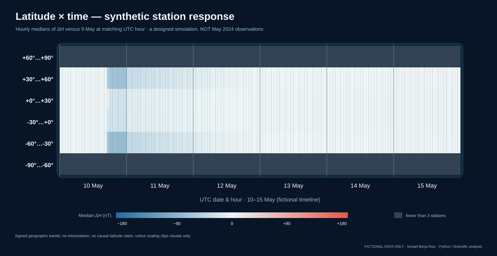 | 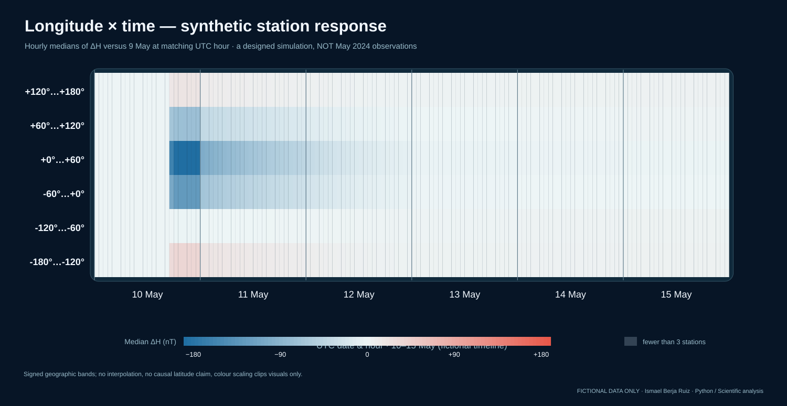 |

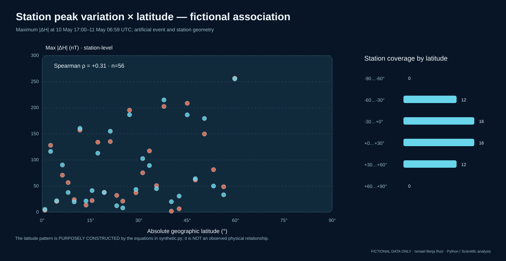

**Pipeline:** derive hourly H medians from valid XYZ (at least **50/60 minutes**); subtract the same UTC-hour station baseline from fictional **9 May**; aggregate signed **30° latitude / 60° longitude** bands only if **≥3 stations** contribute; screen **14 event-window hours** per station and report descriptive rank correlation. The simulated sample has **8,037 valid of 8,064** station-hour comparisons. Its calculated **Spearman ρ ≈ +0.3065** is *deliberately determined by the fictional spatial equations*, **not evidence about the real 2024 storm**.

[**Scientific methodology and reproducibility**](docs/SPATIAL_TEMPORAL_ANALYSIS.md) · [Python analysis module](src/geomag_demo/spatial_temporal.py) · [Synthetic regression tests](tests/test_spatial_temporal.py). No observations or original figures from the private thesis are included.

## Magnetic components, geographic elevation and declination — final thesis-method coverage

The submitted Physics thesis also compared **H, X, Y and Z against geographic latitude**, and **H against longitude and station elevation**. This independent software demonstration now implements the same *questions* on a **completely fictional** dataset. Its component peak magnitude is the largest absolute difference on **artificial 10 May** from the **artificial 9 May 24-hour mean**; this is distinct from the 9 May **same-UTC-hour median** used in the six-day heatmaps above, and distinct from the **real thesis's 8 May** quiet-day reference.

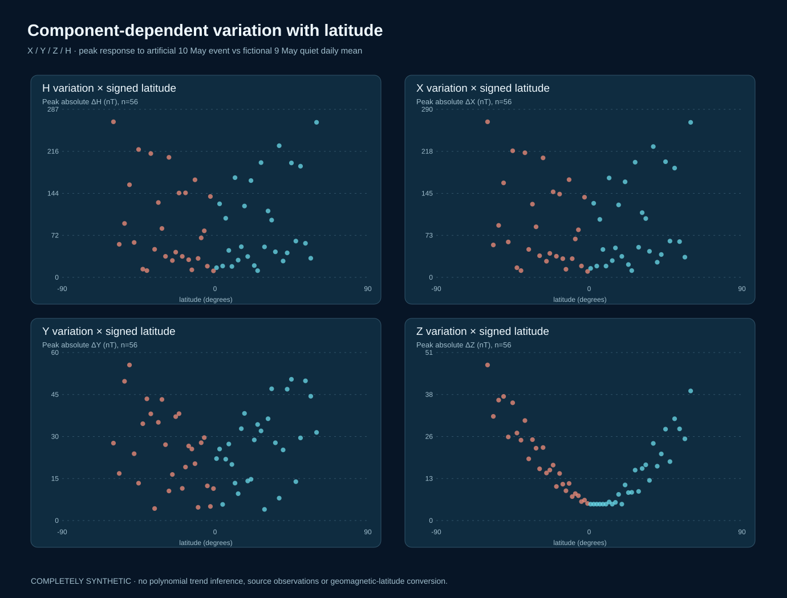

| Geographic longitude vs synthetic H response, and deliberately invented site elevation | Time-dependent synthetic declination D by signed latitude |
| :---: | :---: |
| 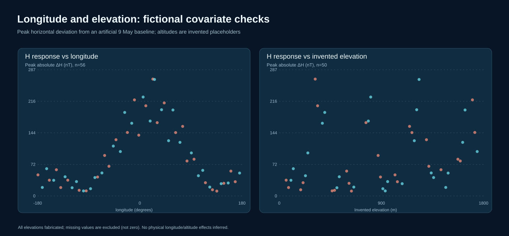 | 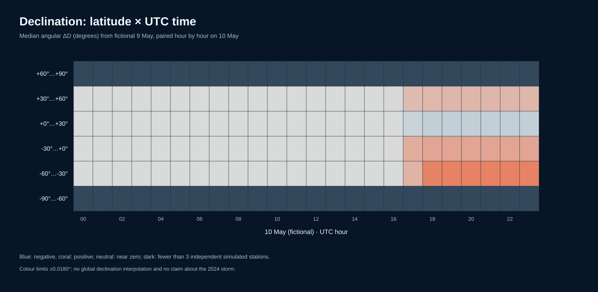 |

The invented elevation values are **not actual observatory altitudes**; six stations deliberately lack elevation. **D is an angle in degrees**, not magnetic intensity in nT. These plots demonstrate quality-controlled computation, not a physical latitude, longitude, elevation or hemispheric effect.

[**How this portfolio maps to the final BSc thesis**](docs/THESIS_METHOD_COVERAGE.md) · [New generator](src/geomag_demo/thesis_geography.py) · [Regression tests](tests/test_thesis_geography.py).

## Data science gallery — all fourteen charts

The remaining time-series, quality and regional plots are embedded below; the two 3D figures, spectrogram and six geographic analysis plots are above. All fourteen SVG outputs are generated using synthetic observations and can be reproduced byte-for-byte.

| Signed latitude-band medians | Longitude-band medians |
| :---: | :---: |
| 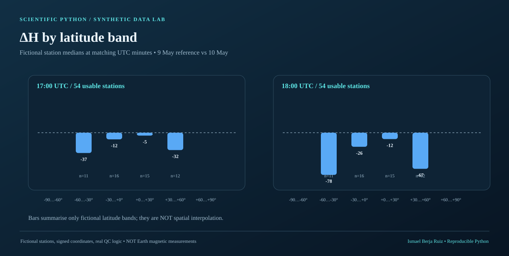 | 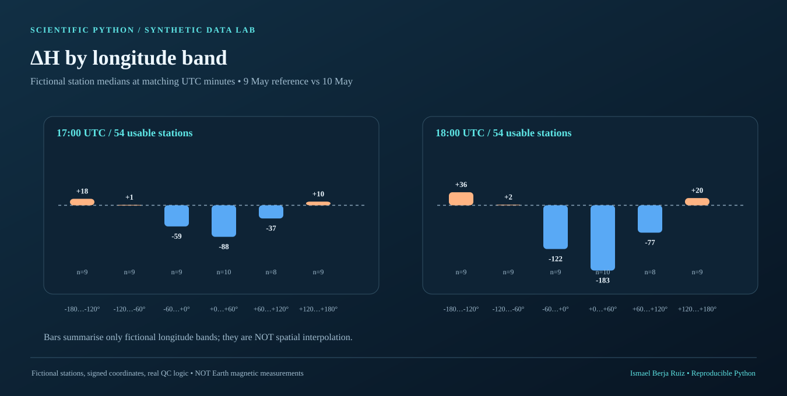 |

| Time-series response with deliberate gaps | Daily H range with missing-day break |
| :---: | :---: |
| 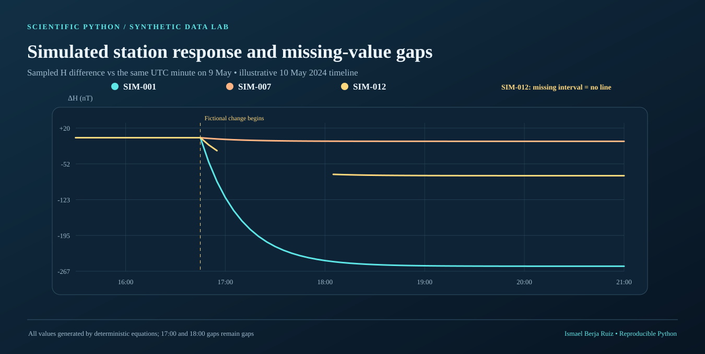 | 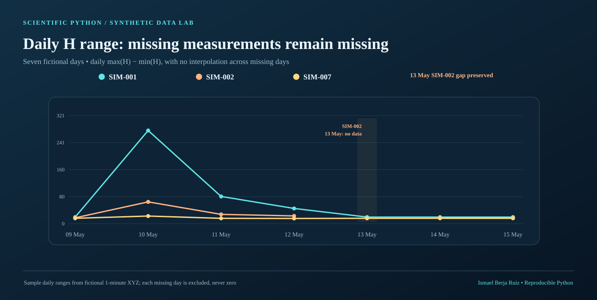 |

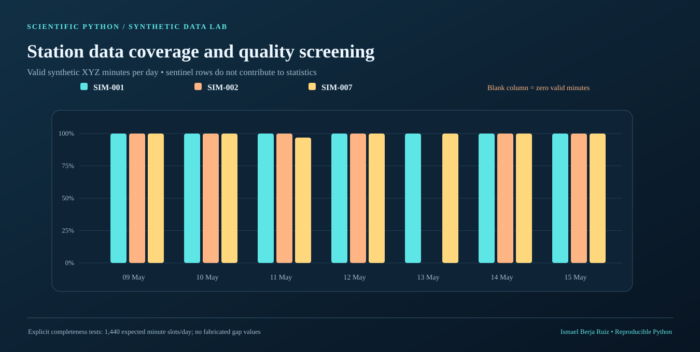

The **13 May SIM-002 missing-day example** demonstrates why a line graph must not join readings across a wholly missing day. The 17:00/18:00 snapshot intentionally excludes two simulated stations whose measurements are absent. **Missing is not zero.**

## Reproduce the project

Only **Python 3.11 or 3.12 and the standard library** are required. No downloads, network requests, API tokens or real observatory files are needed.

```bash
python scripts/build_gallery.py
python scripts/generate_iaga_demo.py
```

The first command deterministically recreates the fourteen SVG figures, standalone interactive HTML, derived fictional station CSV and JSON manifest. The second generates **three fully fictional stations × seven days × 1,440 UTC minutes** of IAGA-style XYZF test data in a new folder under `outputs/` (excluded from Git).

Run the automated tests:

```bash
# Linux/macOS
PYTHONPATH=src python -m unittest discover -s tests -v

# Windows PowerShell
$env:PYTHONPATH = 'src'; python -m unittest discover -s tests -v
```

[GitHub Actions](.github/workflows/ci.yml) runs the tests on Python 3.11 and 3.12, regenerates the entire gallery and checks that its files match the committed figures byte-for-byte.

## Technical skills demonstrated

| Area | Implemented evidence |
| --- | --- |
| **Scientific Python** | [Deterministic synthetic station/XYZ generator](src/geomag_demo/synthetic.py) and [computation module](src/geomag_demo/analysis.py) |
| **Data parsing and QC** | [Strict synthetic IAGA-style parser](src/geomag_demo/analysis.py): UTC-minute validation, duplicate rejection, 99999 sentinels, provenance validation and complete/partial coverage |
| **Time-series and spectral analysis** | Same-UTC-minute baselines, H = √(X² + Y²), F = √(X² + Y² + Z²), daily ranges, gap-aware **Hann STFT / PSD spectrogram** |
| **Geographic component & angular analysis** | [H/X/Y/Z peak comparisons](src/geomag_demo/thesis_geography.py), invented elevation QC, circular declination differences by latitude × UTC hour; [thesis-method crosswalk](docs/THESIS_METHOD_COVERAGE.md) |
| **Spatiotemporal analysis** | Six-day latitude/longitude × UTC-hour medians, sample sufficiency screens, maximum |ΔH| versus geographic latitude and descriptive Spearman ranks on [synthetic data](src/geomag_demo/spatial_temporal.py) |
| **Geospatial aggregation** | 30° latitude × 60° longitude cells; medians only with ≥2 independent fictional stations; signed hemisphere coordinates |
| **3D visualization** | [Dependency-free SVG/Canvas renderer](src/geomag_demo/visuals.py), local N/E/D-to-Cartesian vector projection, rotatable standalone globe |
| **Software engineering** | [Unit tests](tests/), deterministic builds, [CI](.github/workflows/ci.yml), documented limitations, [MIT licence](LICENSE) |

## Repository layout

```text
src/geomag_demo/        Synthetic data, quality controls and rendering
scripts/                Rebuild figures; generate fictional minute records
figures/                Fourteen synthetic SVG figures and offline HTML viewer
tests/                  Regression and gallery-integrity tests
docs/                   Methods, reproducibility and CV-ready summary
.github/workflows/      Python 3.11/3.12 verification
LICENSE                 MIT — newly authored synthetic software only
```

## Interpretation and licensing

The synthetic examples do not establish any physical facts about the 2024 storm, instrument calibration, storm onset or recovery, Dst/Kp indices, or actual spatial Earth-field structure. **No INTERMAGNET data or WDC Kyoto provisional index values have been imported.** The map is deliberately a presentation of **sampled fictional station groups**, not a scientifically validated global field map.

The **MIT licence covers only the code and synthetic materials in this independent repository**. It does not grant any rights to the author's underlying thesis, original observation files or separately maintained private research repository. See the [scientific methodology](docs/METHODOLOGY.md), the [CV/LinkedIn summary](docs/CV_AND_LINKEDIN.md) and the [GitHub publication instructions](docs/PUBLISH_TO_GITHUB.md). A [social preview image](assets/github_social_preview.png) is included for sharing the repository link.

---

**Author:** [Ismael Berja Ruiz](https://github.com/ismaelberja) · BSc Physics, University of Granada · Scientific Python / Data Analysis
