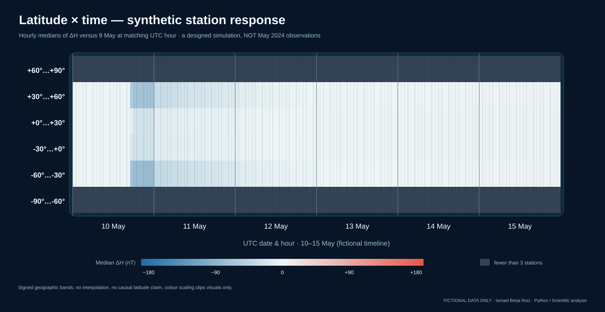
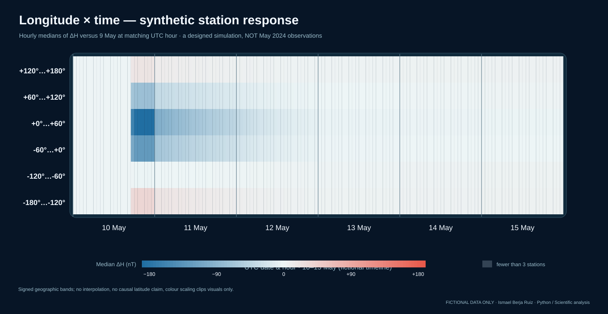
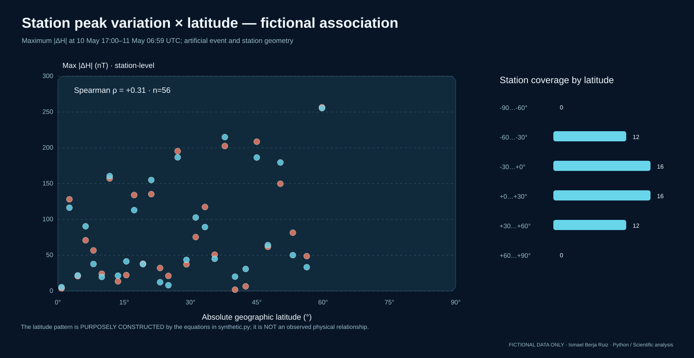

# Geographic dependence and time evolution — an all-synthetic methodology demo

This section adds a scientific-analysis workflow **inspired by the research questions** of the author's BSc Physics thesis, especially geographic dependence and the temporal progression of a geomagnetic disturbance. **None of these plots contains original thesis measurements, station positions, derived results, historical code or scientific findings.** This public project invents 56 `SIM-###` observatories, minute-resolution XYZ observations and a storm-like signal through reproducible equations. The use of May 2024 dates is **fictional test-timestamp labelling**.

## Added scientific-analysis charts







These complement the existing two-time globes, time series and STFT spectrogram by testing a more complete **six-day temporal and geographical workflow**.

## Exact algorithm

- Calculate `H(t) = sqrt(X(t)^2 + Y(t)^2)` for each fictional station and minute.
- Define **the hourly median of at least 50 valid UTC minute samples**; insufficient coverage produces `None`, never zero.
- For each hour of **10–15 May 2024 in the artificial timeline**, calculate `ΔH(s,d,h) = median H(s,d,h) − median H(s,9 May,h)` at the *same UTC clock hour* of the fictional baseline day.
- Partition geography into **six signed 30° latitude bands** and **six 60° longitude bands**. A band × hour is coloured only when **three or more distinct fictional stations** support its median. Less-supported bands remain dark; the globe and heatmaps never interpolate between observations.
- Compare the **maximum absolute hourly ΔH** during a purely illustrative **10 May 17:00–11 May 06:59 UTC** event interval with absolute geographic latitude. Require at least **10 of 14 hours** per station. Report Spearman's rank correlation **descriptively**, showing hemispheres separately and displaying uneven station counts.

This source automatically computes all statistics; the original TFG archive, real indices, calibration data and real observatory locations are not accessed.

## Verification snapshot

The deterministic generator produces **8,064 station–hour comparisons** across 56 fictional stations and 144 hours (six days). **8,037** have paired valid data. The plot of peak amplitude includes **56** eligible fictional stations, with a constructed, **nonphysical** absolute-latitude Spearman coefficient **ρ = +0.3065**. **Do not present this number as an observation about the 2024 geomagnetic storm**: the pattern follows the artificial latitude/longitude equations in `synthetic.py`.

## Reproduce / test

```bash
python scripts/build_gallery.py
PYTHONPATH=src python -m unittest discover -s tests -v
```

The gallery now includes **11 deterministic SVG charts**, three of which illustrate the full spatial × temporal analysis; the existing standalone interactive 3D Earth remains unchanged. GitHub Actions regenerates all figures and verifies **byte-for-byte** reproducibility. The new calculations are in [spatial_temporal.py](../src/geomag_demo/spatial_temporal.py) with [offline synthetic tests](../tests/test_spatial_temporal.py).

## Why the distinction matters

The geographic coordinates here are **geographic**, not corrected geomagnetic latitudes. Neither a fictional rank correlation nor raw band medians establish a *physical global latitude effect*; unweighted station sampling is unequal by location. Correlation can be distorted by local solar time, the choice of quiet reference, station selection, product stage and longitudinal asymmetries in **real** observational studies. Real thesis phase/recovery results require a separate source-method reconciliation before scientific release.

The technical competence illustrated in a public CV is **reproducible scientific programming**, not a claim to have publicly distributed the original restricted research results.
